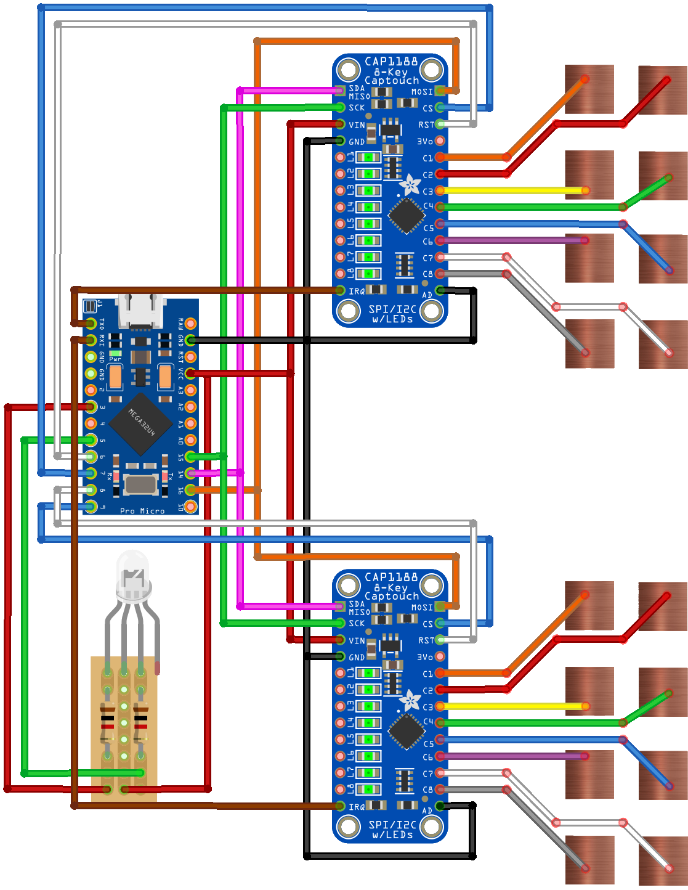
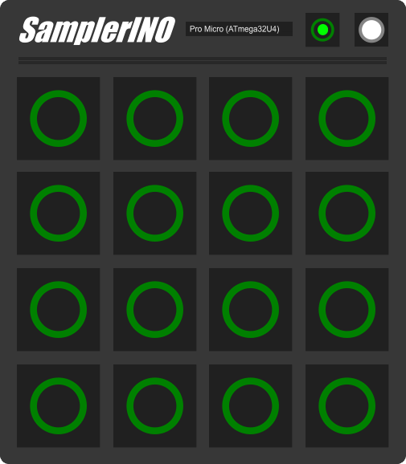

# SamplerINO 🔲

## Table of Contents

- [Description](#description)
    - [Project](#project)
    - [Repository](#repository)
    - [Technical Details](#technical-details)
- [Gallery](#gallery)
    - [Circuit Diagram](#circuit-diagram)
    - [3D Models](#3d-models)
    - [Hardware Assembly](#hardware-assembly)
    - [User Interface](#user-interface)
- [License](#license)

## Description

### Project
**SamplerINO** utilizes an *ATmega32U4* microcontroller and two *CAP1188* 8-channel capacitive touch sensor modules to assemble a USB MIDI controller featuring 16 touch-sensitive pads. The prototype circuit board is housed inside a custom-designed 3D printed enclosure, which facilitates the installation of the pads, as well as an LED indicator and a power switch. You can watch a video demonstration of this hardware MIDI controller and its dedicated software sampler at the following [link](https://youtu.be/IzE63Gio5Jo).

### Repository
The code in this repository is organized into several directories, with the source (`.cpp`) and header (`.h`) files of the controller located in the [*src*](src) and [*include*](include) directories, respectively. The *Max* patch implementing the user interface of the accompanying sampler, along with a collection of drum samples gathered from various royalty-free web sources, are contained in the [*max*](max) directory. Lastly, the 3D model (`.stl`) files are located in the [*3d*](3d) directory, while the [*img*](img) directory contains all images displayed in the present documentation.

### Technical Details
This project was developed using `Max 8.1.11` and *Visual Studio Code* on `Windows 10`, with the *PlatformIO* extension employed to upload the code to the *ATmega32U4* microcontroller embedded in an *Arduino*-compatible *Pro Micro* board. The controller pads were made by cutting 4×4cm pieces from a 0.5mm thick copper sheet, while the enclosure screw holes were designed for M2 threaded heat inserts. Lastly, a common anode RGB LED was used for the LED indicator, connected to 1KΩ resistors to prevent excessive current.

## Gallery

### Circuit Diagram

### 3D Models
")
")
")

### Hardware Assembly
")
")
")
")

### User Interface

## License

*SamplerINO* © *2024* by *Alexandros Iliadis* is licensed under the [MIT License](https://choosealicense.com/licenses/mit/).

A short and simple permissive license with conditions only requiring preservation of copyright and license notices. Licensed works, modifications, and larger works may be distributed under different terms and without source code.

See the [`LICENSE.md`](LICENSE.md) file for more details.